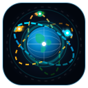

# 🛰️ AstroTrack: Real-Time Multi-Satellite Tracker & 4K Earth Cam

A state-of-the-art aerospace web dashboard that tracks multiple space stations and Earth observation satellites in real time, featuring interactive Esri satellite imagery and an embedded 24/7 Live 4K Ultra-HD Earth camera stream from space.



---

## 🌟 Key Features

### 🛰️ 1. Multi-Satellite Real-Time Tracking
- **[1A] International Space Station (ISS)** - NASA • ESA • JAXA • Roscosmos • CSA (NORAD #25544, 51.6° Inclination)
- **[1B] Tiangong Space Station (CSS) & Hubble (HST)** - CNSA / NASA (NORAD #48274 / #20580)
- **[1C] Cartosat-3 & RISAT-2BR1 (ISRO India 🇮🇳)** - Sun-synchronous Polar Orbit (NORAD #44804 / #44857, 97.4° Inclination)
- **Real-Time SGP4 Orbit Propagation:** Client-side mathematical orbital calculation using official NORAD Two-Line Element (TLE) sets via `satellite.js` with zero API rate limits.
- **3D Orbital Distance:** Live calculation of 3D Euclidean distances between satellites (`ISS ↔ Tiangong` and `ISS ↔ Cartosat-3`).

### 🎥 2. Live 4K Earth Cam Stream (Draggable Window)
- **Sen 4K ISS Live Earth Feed:** 24/7 Ultra-HD live stream directly from Sen's 4K space cameras mounted on the ISS.
- **NASA ISS HD Earth Stream:** Live video from NASA external space station cameras.
- **Draggable Window:** Grab and reposition the live camera window anywhere across the dashboard.
- **Compact Floating Pill:** Minimize the camera into an ultra-sleek status pill (`[⠿] [🔴 Live] Live 4K Earth Cam [🗖] [✕]`).

### 🗺️ 3. 100% Free Public GIS Maps (Zero API Keys)
- **Satellite Imagery:** Ultra high-resolution Esri World Imagery + boundary reference overlays.
- **Dark Space Canvas:** Sleek dark GIS basemap for tactical night tracking.
- **World Topo / Street:** Detailed geographic topography.

### 🎨 4. Aerospace Design & Themes
- **Light & Dark Mode:** One-click instant theme toggle with saved localStorage preferences.
- **Custom Branding:** AstroTrack orbital logo and vector favicon.
- **Dark Glassmorphism Popups:** High-tech telemetry cards and popups on the Leaflet map.

---

## 🚀 Quick Start

1. **Clone the repository:**
   ```bash
   git clone https://github.com/Shafaisalnawazkhan/satellite-tracker.git
   cd satellite-tracker
   ```

2. **Run locally:**
   No build steps or dependencies required! You can open `index.html` directly or serve via Python:
   ```bash
   python -m http.server 5500
   ```
   Open `http://localhost:5500` in your web browser.

---

## 📁 Project Structure

```
satellite-tracker/
│
├── index.html                   # Main dashboard structure & layout
├── style.css                    # Design system, themes & animations
├── main.js                      # SGP4 orbit engine, Leaflet & drag logic
│
└── icon/                        # Vector assets
    ├── orbit_logo.svg           # AstroTrack Brand Emblem
    ├── favicon.svg              # Browser tab icon
    ├── International_Space_Station.svg
    ├── isro_satellite.svg       # Custom Indian Tricolor satellite SVG
    └── tiangong.svg
```

---

## 🛠️ Technologies Used

- **HTML5 & CSS3** (Vanilla CSS, Glassmorphism, CSS Custom Properties)
- **Vanilla JavaScript (ES6+)**
- **[Leaflet.js](https://leafletjs.com/)** (Interactive geospatial mapping)
- **[satellite.js](https://github.com/shashwatak/satellite-js)** (SGP4/SDP4 satellite orbit calculations)
- **Esri ArcGIS Online** (Free public satellite tile layers)
- **YouTube Embed API** (Live 4K ISS camera stream)

---

## 👨‍💻 Author

- **Shafaisalnawazkhan** - [GitHub Profile](https://github.com/Shafaisalnawazkhan)

---

*Made with ❤️ for space exploration enthusiasts! 🚀*
